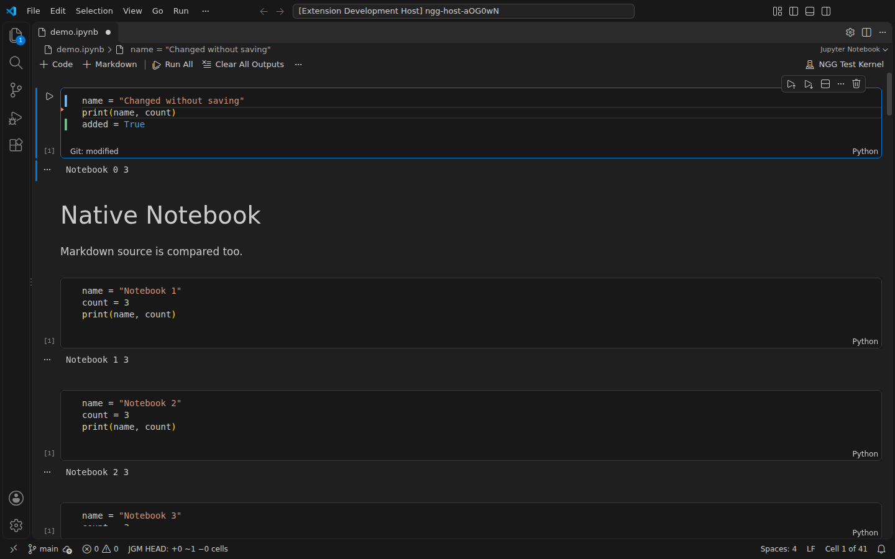
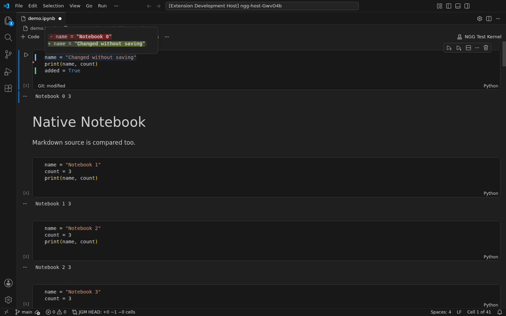
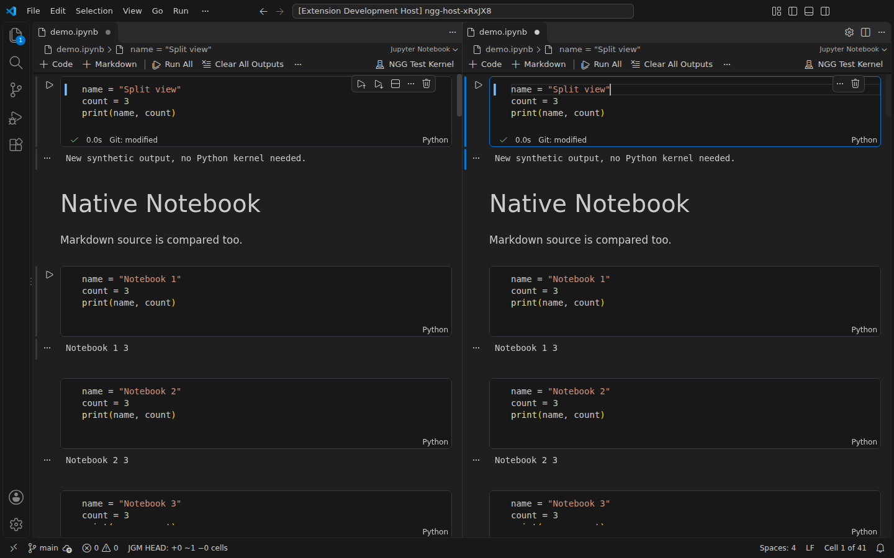

# Jupyter Notebook Git Marks

[Get started](#get-started) · [Baselines](#choose-a-baseline) · [Settings](#settings) · [Troubleshooting](#troubleshooting) · [Limits](#compatibility-and-limits) · [简体中文](docs/README.zh-CN.md)

See line-level Git changes while editing `.ipynb` files in VS Code's native Jupyter Notebook editor, including changes you have not saved yet.

| Mark | Source change |
| --- | --- |
| **Green** | Added lines |
| **Blue** | Modified lines |
| **Red** | Deleted lines, marked near their former position |

Undo back to the baseline and the marks disappear.

Adjacent removed and added lines form a replacement block. Its full current range is blue, matching VS Code's Git gutter; a pure insertion is green and a pure deletion has a red marker. These colors describe text changes, not which statements replace each other.

## Get started

Requires VS Code Desktop **1.130.0+**, Git, and the built-in Git and Notebook support. No Python environment or running Jupyter kernel is needed to calculate source changes.

This README describes the source checkout. The Marketplace release may be older; check the installed version in Extensions.

1. Install [Jupyter Notebook Git Marks from the Visual Studio Marketplace](https://marketplace.visualstudio.com/items?itemName=StevenYang0316-5274.notebook-git-gutter), or use **Extensions → … → Install from VSIX…** for a local build.
2. Open a Git-tracked `.ipynb` in VS Code's native Notebook editor.
3. Edit a code cell or the source of a Markdown cell. Marks update without saving.

Right-click beside a changed line in the gutter and choose **Show Change**. VS Code's native hover opens inside the cell, showing the original and current source or the deleted source and its location. Hovering over a changed source line shows the same details. No separate editor opens. In split view, hover over the changed source in the desired editor; the gutter action cannot identify which copy you clicked.

The preview uses VS Code's diff theme colors: red `-` rows for original source, green `+` rows for current source, and stronger backgrounds on changed words. The **JGM** status item identifies the baseline (**HEAD** or **index**); current source includes unsaved edits. Source text is never translated.

Long lines show a short excerpt around each edit; unchanged passages are collapsed with `…`. Short lines keep the full source for context.

The **JGM** status item summarizes added, modified, deleted, and moved cells. Deleted whole cells appear in this summary because they no longer have an editor.

A spinning icon means analysis is pending. A warning icon means some cells could not be analysed or the baseline is unavailable. Hover over the status item for the reason; click it for diagnostics.

The Command Palette provides:

- **Jupyter Notebook Git Marks: Toggle**
- **Jupyter Notebook Git Marks: Refresh**
- **Jupyter Notebook Git Marks: Show Diagnostics**
- **Jupyter Notebook Git Marks: Previous Changed Cell** / **Next Changed Cell**

Navigation selects and reveals confirmed added, modified, or moved cells for the selected baseline, wrapping at either end. While analysis is pending or unavailable, retry when the status is ready. Ambiguous cells are skipped; deleted whole cells have no destination.

## Choose a baseline

**HEAD** is the default. It compares the current in-memory source with the latest commit. Staging with `git add` does not clear uncommitted changes.

**index** compares the current in-memory source with the staging area. Stage or unstage a notebook to update this baseline. An intent-to-add entry (`git add -N`) counts as a new file, until its content is staged.

Git changes refresh through VS Code's built-in Git extension. Use **Refresh** if Git auto-refresh is disabled or you need to retry a failed read.

For a confirmed rename, **HEAD** follows the original path and **index** uses the current staged path. If the rename source cannot be resolved, comparison pauses instead of using another file's content.

## Settings

| Setting | Default | Description |
| --- | --- | --- |
| `notebookGitGutter.enabled` | `true` | Show line marks. |
| `notebookGitGutter.baseline` | `HEAD` | Compare against `HEAD` or `index`. |
| `notebookGitGutter.debounceMs` | `200` | Delay after typing, from 0 to 2000 ms. |
| `notebookGitGutter.showCellSummary` | `true` | Show an additional cell summary. |

## Troubleshooting

| What you see | What to check |
| --- | --- |
| No line marks | Check **JGM** first: the source may match the baseline, analysis may be pending, or comparison may be unavailable. Also check that marks are enabled and a Markdown cell is in source mode. |
| Analysis incomplete | Hover over **JGM** or the cell summary for the reason. Use **Refresh** to retry a computation limit. Ambiguous cells stay unmarked when a reliable match cannot be established. |
| Baseline exceeds 8 MiB | The limit includes saved outputs and metadata. Use a file-level review tool for notebooks above this limit. |
| Merge conflict | Resolve the conflict with your usual Git tools, then use **Refresh** if comparison does not resume. This extension does not resolve conflicts. |
| Git unavailable or marks do not refresh | Enable the built-in Git extension, make sure Git is installed in the workspace environment, and use **Refresh**. In Remote SSH / WSL, check the remote environment. |
| An update has no effect in SSH / WSL | Install the VSIX from the connected remote window, then run **Developer: Reload Window**. Use **Show Diagnostics** to check the `extension` version reported by the running extension host. |

Notebooks edited by another tool before opening are supported. Cell matching uses reliable IDs and source content, including preserved source lines. If a cell cannot be matched confidently, **analysis incomplete** means its changes have not been determined; it does not mean the cell is unchanged. Refresh can retry a computation limit, but cannot resolve genuinely ambiguous matches.

## Compatibility and limits

Supports code and Markdown source in nbformat 4 notebooks. Outputs, execution counts, and unrelated metadata do not create source marks. It does not stage, revert, or commit files.

For Remote SSH / WSL, install the extension in the remote workspace. Visual testing has been performed on Linux Desktop; Windows, macOS, and remote sessions have not been visually verified. Browser-based JupyterLab, vscode.dev, virtual workspaces, and untrusted workspaces are not supported.

During analysis, marks for edited cells are temporarily hidden so old line positions are never presented as current results.

VS Code's native Git Quick Diff does not support Notebook cell models in the tested version. These marks use the public decoration API. A single left-click cannot open Git's inline diff popup; use the right-click action above. The native hover is not Git's embedded diff editor. Small red triangles sit near line boundaries, within the gutter image area. They cannot extend between rows exactly like native Git triangles.

Word previews support up to 64,000 combined UTF-16 code units and eight edits within a computation budget. Larger or complex edits fall back to source blocks, limited to 4000 characters per section and 400 displayed rows per preview, with a truncation notice. Replacements reserve 200 rows for each side. Edited cells cannot display previews from an older document version.

The baseline file is limited to **8 MiB including outputs and metadata**, with at most 2000 cells. Cell diffs are limited to 512,000 combined characters and 20,000 combined lines; combined notebook source is limited to 16,000,000 UTF-16 code units, with an additional computation budget. Exceeding a limit shows an incomplete or unavailable comparison.

Git reads run locally with at most four subprocesses and 128 queued commands. If the queue fills, use **Refresh** after it drains.

Raw cells and inputs exceeding the analysis limits show an incomplete-analysis state. Repeated cells, moves combined with edits, and complex cell splits or merges may also remain incomplete when neither identity nor source content establishes a reliable match. Read errors and merge conflicts show an error rather than treating the baseline as empty. Gutter marks may overlap breakpoints or marks from other extensions.

## Related tools

| Tool | When it helps |
| --- | --- |
| [nbdime](https://github.com/jupyter/nbdime) | Review and merge notebook files with structure-aware diffs. |
| [JupyterLab Git](https://github.com/jupyterlab/jupyterlab-git) | Work with Git inside browser-based JupyterLab. This VS Code extension does not run in JupyterLab. |
| [Jupytext](https://github.com/jupytext/jupytext) | Pair notebooks with text files for text-based workflows. Git Marks always compares the `.ipynb` baseline; it does not read a paired `.py` or `.md` as the baseline. |

For development and validation commands, see [the contributor notes](docs/verification.md#构建与调试). Report problems through [GitHub Issues](https://github.com/steventimes/git-for-jupyterNotebook/issues), including the VS Code version, selected baseline, and diagnostic error code. Review diagnostics before sharing and remove any private paths or filenames. Notebook source is not needed for an initial report.

## License

Versions 0.1.1 and later use a [source-available license](LICENSE), rather than a standard open-source license. Learning, personal and internal use, modifications, and attributed source forks are permitted. Public redistribution as an extension, including Marketplace uploads and public VSIX downloads, requires prior written permission. Do not misrepresent copied work as your own.

Previously granted MIT rights remain valid for [the historical MIT version](LICENSES/MIT-legacy.txt); the new terms do not withdraw those permissions. [Third-party components](LICENSES/THIRD_PARTY_NOTICES.md) retain their own licenses.

Official publisher: **StevenYang0316-5274**. [Source code and issue tracker](https://github.com/steventimes/git-for-jupyterNotebook).
