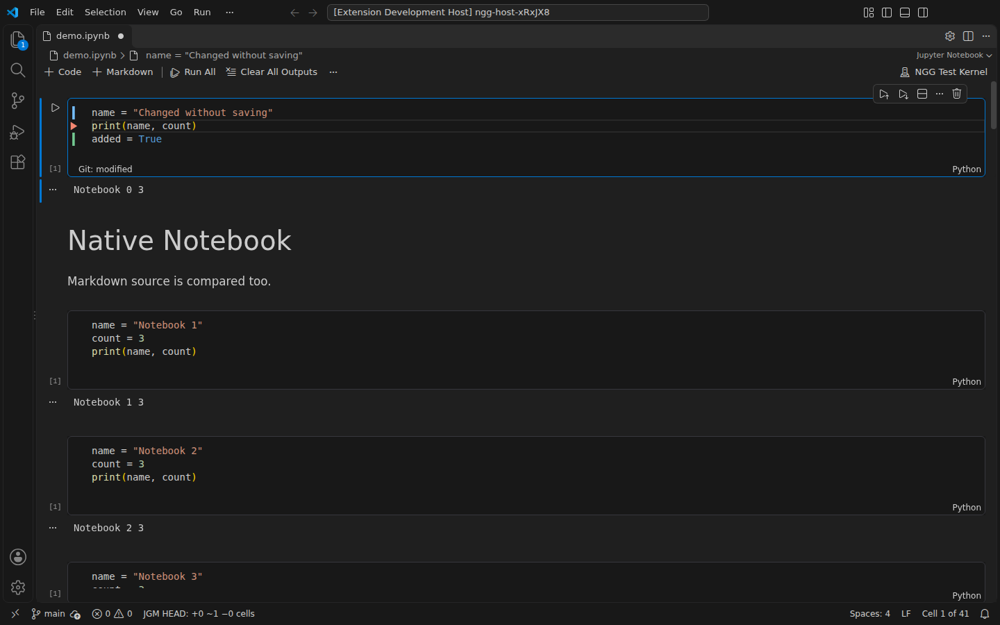
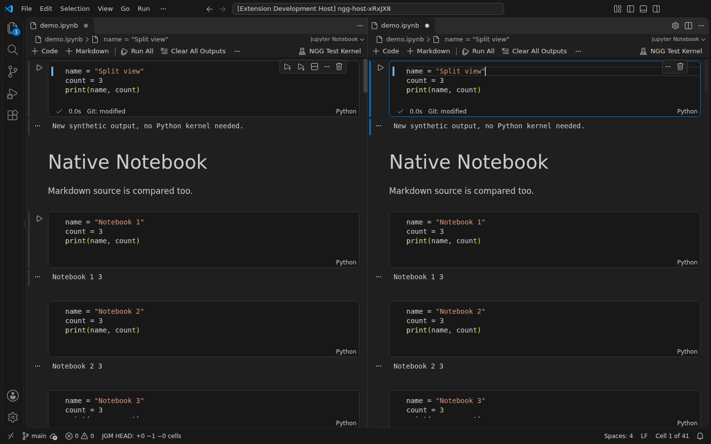

# Jupyter Notebook Git Marks

[English](README.md) | [简体中文](README.zh-CN.md)

See line-level Git changes while editing `.ipynb` files in VS Code's native Jupyter Notebook editor, including changes you have not saved yet.

- **Green** marks added lines.
- **Blue** marks modified lines.
- **Red** marks deleted lines near their former position.
- Undo back to the baseline and the marks disappear.

## Get started

Requires VS Code Desktop **1.141.0+**, Git, and the built-in Git and Notebook support. No Python environment or running Jupyter kernel is needed to calculate source changes.

Install the extension, open a Git-tracked `.ipynb`, and edit a cell. For a local VSIX, use **Extensions → … → Install from VSIX…**. Markdown cells show marks while you edit their source.

Hover over a changed source line for a brief explanation and deleted text. The **JGM** status item summarizes added, modified, deleted, and moved cells. Deleted whole cells appear in this summary because they no longer have an editor.

The Command Palette provides:

- **Jupyter Notebook Git Marks: Toggle**
- **Jupyter Notebook Git Marks: Refresh**
- **Jupyter Notebook Git Marks: Show Diagnostics**

## Choose a baseline

**HEAD** is the default. It compares the current in-memory source with the latest commit. Staging with `git add` does not clear uncommitted changes.

**index** compares the current in-memory source with the staging area. Stage or unstage a notebook to update this baseline.

Git changes refresh through VS Code's built-in Git extension. Use **Refresh** if Git auto-refresh is disabled or you need to retry a failed read.

## Settings

| Setting | Default | Description |
| --- | --- | --- |
| `notebookGitGutter.enabled` | `true` | Show line marks. |
| `notebookGitGutter.baseline` | `HEAD` | Compare against `HEAD` or `index`. |
| `notebookGitGutter.debounceMs` | `200` | Delay after typing, from 0 to 2000 ms. |
| `notebookGitGutter.showCellSummary` | `true` | Show an additional cell summary. |

## Compatibility and limits

Supports code and Markdown source in nbformat 4 notebooks. Outputs, execution counts, and unrelated metadata do not create source marks. It does not stage, revert, or commit files.

For Remote SSH / WSL, install the extension in the remote workspace. Visual testing has been performed on Linux Desktop; Windows, macOS, and remote sessions have not been visually verified. Browser-based JupyterLab, vscode.dev, virtual workspaces, and untrusted workspaces are not supported.

Raw cells, ambiguous repeated cells, complex cell splits or merges, and inputs exceeding the analysis limits show an incomplete-analysis state. Read errors and merge conflicts show an error rather than treating the baseline as empty. Gutter marks may overlap breakpoints or marks from other extensions.

## License

Version 0.1.1 uses a [source-available license](LICENSE), rather than a standard open-source license. Learning, personal and internal use, modifications, and attributed source forks are permitted. Public redistribution as an extension, including Marketplace uploads and public VSIX downloads, requires prior written permission. Do not misrepresent copied work as your own.

Previously granted MIT rights remain valid for [the historical MIT version](LICENSES/MIT-legacy.txt); the new terms do not withdraw those permissions. [Third-party components](THIRD_PARTY_NOTICES.md) retain their own licenses.

Official publisher: **StevenYang0316-5274**. [Source code and issue tracker](https://github.com/steventimes/git-for-jupyterNotebook).
