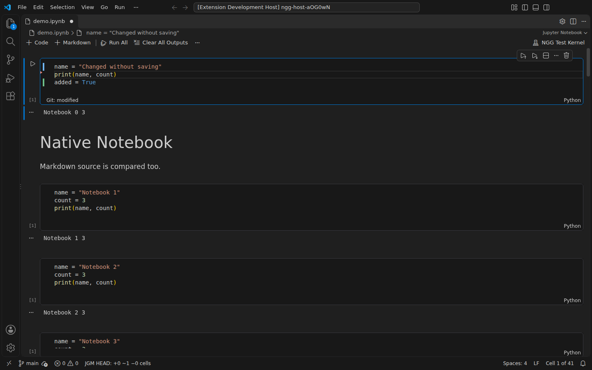
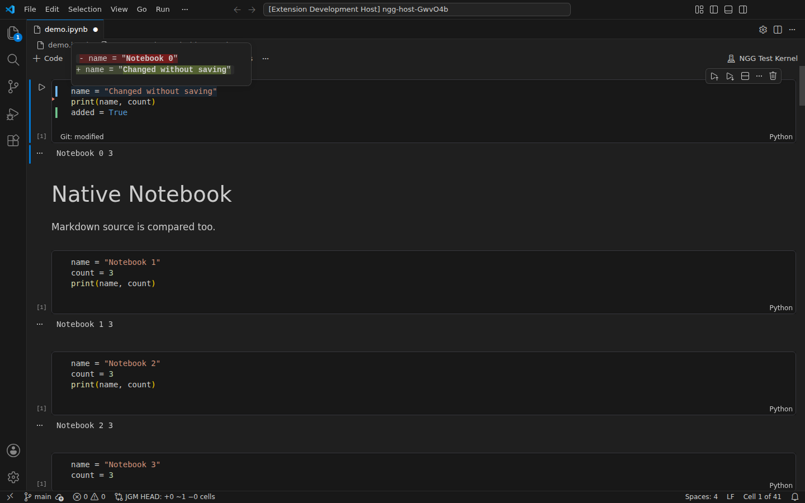
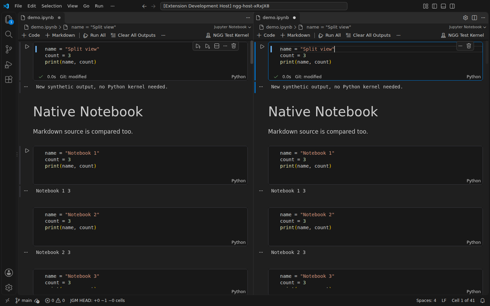

# Jupyter Notebook Git Marks

[开始使用](#开始使用) · [比较基准](#选择比较基准) · [配置](#配置) · [常见问题](#常见问题) · [兼容性](#兼容性与限制) · [English](../README.md)

在 VS Code 原生 Jupyter Notebook 编辑器中直接查看 `.ipynb` 的 Git 行级变化，尚未保存的输入也会更新。

| 标记 | 源码变化 |
| --- | --- |
| **绿色** | 新增行 |
| **蓝色** | 修改行 |
| **红色** | 删除行，在原位置附近显示 |

Undo 恢复到基准内容后，标记自动消失。

相邻的删除和插入会组成一个替换块，当前侧整段显示蓝色，与 VS Code 的 Git gutter 一致。纯新增显示绿色，纯删除显示红色标记。这些颜色描述文本变化，不表示哪条语句在语义上替换了另一条。

## 开始使用

需要 VS Code Desktop **1.130.0+**、Git，以及已启用的内置 Git 和 Notebook 支持。计算源码变化不需要 Python 环境或运行 Jupyter kernel。

本文档对应仓库源码；Marketplace 发布版可能较早，请在扩展详情页核对安装版本。

1. 从 [Visual Studio Marketplace](https://marketplace.visualstudio.com/items?itemName=StevenYang0316-5274.notebook-git-gutter) 安装扩展，或通过 **扩展 → … → 从 VSIX 安装…** 安装本地构建的包。
2. 在 VS Code 原生 Notebook 编辑器中打开 Git 已跟踪的 `.ipynb`。
3. 编辑代码 Cell 或 Markdown 的源码，无需保存即可看到标记。

在有变化的行号或标记区域右键，选择 **Show Change**。VS Code 原生悬停框会在当前 Cell 内显示修改前后的源码，或删除内容及其位置。悬停在对应源码行上也能查看，不会另开编辑器。分屏时，请在需要查看的那一侧悬停源码。右键菜单无法识别点击的是哪个分屏，因此不会猜测并切换编辑器。

预览使用 VS Code 的 diff 主题颜色：红色 `-` 行表示原文，绿色 `+` 行表示当前源码，真正变化的字词再加一层高亮。**JGM** 状态项标明所选基准 **HEAD** 或 **index**，当前源码包含未保存的修改。扩展不会翻译源码。

长行只展开各处修改附近的片段，未改的长段文字用 `…` 收起；短行保留完整源码供对照。

底部 **JGM** 状态汇总整 Cell 的新增、修改、删除和移动数量。整个 Cell 被删除后没有对应编辑器，因此只在这里汇总。

旋转图标表示正在分析；警告图标表示部分 Cell 未能完成分析，或基准无法读取。悬停状态项可查看原因，点击可打开诊断。

命令面板提供：

- **Jupyter Notebook Git Marks: Toggle**，开关标记。
- **Jupyter Notebook Git Marks: Refresh**，手动刷新。
- **Jupyter Notebook Git Marks: Show Diagnostics**，查看诊断。
- **Jupyter Notebook Git Marks: Previous Changed Cell** / **Next Changed Cell**，跳到上一个／下一个变更 Cell。

导航按当前基准定位并显示已确认新增、修改或移动的 Cell，走到首尾会循环。分析中或基准不可用时需等状态恢复后重试；身份不明确的 Cell 会跳过，整 Cell 删除没有可跳转的位置。

## 选择比较基准

默认使用 **HEAD**，比较当前内存源码与最新提交。执行 `git add` 不会清除尚未提交的变化。

**index** 比较当前内存源码与暂存区。暂存或取消暂存 Notebook 后，基准随之更新。`git add -N` 只记录准备加入的文件，在真正暂存内容前按新增文件处理。

Git 变化通过 VS Code 内置 Git 扩展触发刷新。关闭 Git 自动刷新或需要重试读取时，可以执行 **Refresh**。

对于已确认的重命名，**HEAD** 追溯原路径，**index** 使用当前暂存路径。原路径无法可靠解析时暂停比较，不拿其他文件的内容作为基准。

## 配置

| 配置 | 默认值 | 含义 |
| --- | --- | --- |
| `notebookGitGutter.enabled` | `true` | 显示行级标记。 |
| `notebookGitGutter.baseline` | `HEAD` | 比较 `HEAD` 或 `index`。 |
| `notebookGitGutter.debounceMs` | `200` | 输入后的延迟，范围 0–2000 ms。 |
| `notebookGitGutter.showCellSummary` | `true` | 显示辅助 Cell 汇总。 |

## 常见问题

| 现象 | 排查方法 |
| --- | --- |
| 没有行级标记 | 先查看 **JGM**：源码可能与基准一致，也可能正在分析或无法比较。同时检查扩展是否启用，Markdown 是否处于源码编辑状态。 |
| 分析未完成 | 悬停 **JGM** 或 Cell 汇总查看原因。计算超时可执行 **Refresh** 重试；无法可靠对应的 Cell 会继续保持无标记。 |
| 基准超过 8 MiB | 上限包含已保存的输出和 metadata。超过上限的 Notebook 可使用文件级审阅工具。 |
| 合并冲突 | 使用平常的 Git 工具解决冲突；若比较没有恢复，再执行 **Refresh**。本扩展不解决冲突。 |
| Git 不可用或标记不刷新 | 检查内置 Git 扩展已启用，工作区环境中已安装 Git，再执行 **Refresh**。Remote SSH / WSL 需要检查远端环境。 |
| SSH / WSL 中更新后没有变化 | 在已连接远端的窗口中安装 VSIX，然后执行 **Developer: Reload Window**。通过 **Show Diagnostics** 的 `extension` 字段确认实际运行的扩展宿主版本。 |

支持打开已被其他工具修改的 Notebook。Cell 匹配会使用可信 ID 和源码内容，包括保留下来的完整源码行。无法可靠匹配时，**分析未完成**表示尚未确定该 Cell 的变化，不表示它没有修改。Refresh 可以重试计算超限，但不能消除真正的匹配歧义。

## 兼容性与限制

支持 nbformat 4 的代码和 Markdown 源码。outputs、execution_count 和无关 metadata 变化不会产生源码标记。扩展不执行暂存、回滚或提交操作。

Remote SSH / WSL 窗口中需要把扩展安装到远端工作区。当前视觉验收平台为 Linux Desktop，Windows、macOS 和远端会话尚未实际视觉验收。不支持浏览器中的 JupyterLab、vscode.dev、虚拟工作区和未信任工作区。

等待分析时，发生编辑的 Cell 会暂时隐藏标记，避免把旧行号显示为当前结果。

已测试版本的 VS Code 内置 Git Quick Diff 不支持 Notebook Cell 模型。目前使用公开装饰 API，无法通过左键单击标记打开 Git 的内嵌差分弹窗。右键操作使用 VS Code 原生悬停框，不是 Git 的内嵌差分编辑器。红色小三角靠近行边界显示，但受 gutter 图标区域限制，无法像内置 Git 一样跨在两行之间。

字词预览支持修改前后合计最多 64,000 个 UTF-16 单元、8 处修改，另有计算时间预算。过大或复杂的修改会退回源码块，每段最多显示 4000 个字符、整个预览最多 400 行，超出时注明已截断。替换内容为修改前后各保留 200 行额度。Cell 编辑后不会继续显示旧文档版本的预览。

基准文件上限为 **8 MiB，包含输出和 metadata**，最多支持 2000 个 Cell。单 Cell 差分的基准与当前文本合计不超过 512,000 个字符和 20,000 行，Notebook 基准与当前源码合计上限为 16,000,000 个 UTF-16 单元，另外还有计算时间预算。超限时会明确显示未完成分析或无法比较。

Git 只执行本地读取，同时最多运行 4 条命令，最多排队 128 条。队列满时会明确提示，可以在读取结束后执行 **Refresh**。

Raw Cell 和超限输入会显示未完成分析。重复 Cell、同时移动和修改的 Cell、复杂拆分或合并，也可能因为身份和源码内容都不足以建立可靠匹配而保持未完成状态。读取失败和合并冲突会显示错误，不会误当成空基准。行号旁的标记可能与断点或其他扩展的装饰重叠。

## 相关工具

| 工具 | 适合的场景 |
| --- | --- |
| [nbdime](https://github.com/jupyter/nbdime) | 按 Notebook 结构审阅和合并文件。 |
| [JupyterLab Git](https://github.com/jupyterlab/jupyterlab-git) | 在浏览器中的 JupyterLab 内使用 Git。本扩展运行在 VS Code 中，不能安装到 JupyterLab。 |
| [Jupytext](https://github.com/jupytext/jupytext) | 将 Notebook 与文本文件配对，便于文本工作流。Git Marks 始终读取 `.ipynb` 的 Git 基准，不会改用配对的 `.py` 或 `.md`。 |

开发和验证命令见[贡献者说明](verification.md#构建与调试)。遇到问题可通过 [GitHub Issues](https://github.com/steventimes/git-for-jupyterNotebook/issues) 反馈，附上 VS Code 版本、所选基准和诊断错误码。分享诊断前请检查并去除私人路径或文件名；首次反馈不需要提供 Notebook 源码。

## 许可证

0.1.1 及后续版本采用[源码可用许可证](../LICENSE)，不属于标准开源许可。允许学习、个人和组织内部使用、修改及注明来源的源码 fork。未经事先书面许可，不得将其作为扩展重新上架或公开分发 VSIX，也不得冒认复制代码的原创作者。

[历史 MIT 版本](../LICENSES/MIT-legacy.txt)的既有授权继续有效，新条款不能追溯收回这些权限。[第三方组件](../LICENSES/THIRD_PARTY_NOTICES.md)保留各自许可证。

官方 publisher 为 **StevenYang0316-5274**。[源码与问题反馈](https://github.com/steventimes/git-for-jupyterNotebook)。
